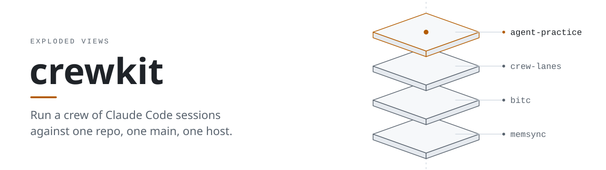
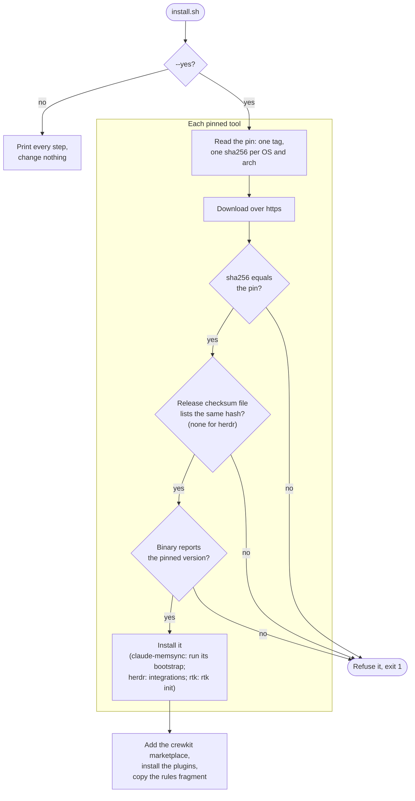
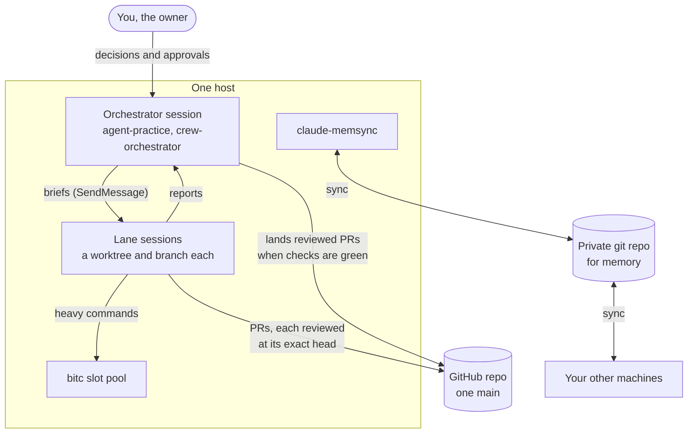

<h1>
  <picture>
    <source media="(prefers-color-scheme: dark)" srcset="docs/assets/crewkit-dark.svg">
    
  </picture>
</h1>

[](LICENSE)

Practices, plugins and a checksum-verifying installer for running a crew of Claude Code sessions
against one repo, one `main` and one host, with one session (the Orchestrator) coordinating the
rest.

## Nouns you need to know

| Noun | What it is | Also called in these docs |
|---|---|---|
| **Fleet** | Everything crewkit runs for one owner: all the crews, on all the hosts. | |
| **Crew** | A group of hands working on one project, led by a crew lead. | |
| **Hand** | One Claude Code session doing work in a crew. | session (a Claude Code session; a lane is one), worker; agent, when it means such a session (elsewhere in these docs an agent is a CLI, such as Claude Code or Codex) |
| **Crew lead** | The hand that orchestrates a crew. It hands out work, tracks status, reviews and lands, and reports up. | the Orchestrator (the `crew-orchestrator` plugin), the coordinating session |
| **Subagent** | A short-lived helper a hand starts for one task. It reports back to that hand and never messages anyone else. | |
| **Mission control (MC)** | The hand that runs the fleet for the owner. It talks to every crew lead, carries the owner's decisions, and keeps the owner's to-do list and brief. | |
| **Bridge** | The hand on each host that carries messages between hosts. Only bridges cross hosts; inside its host, a bridge routes to the right hand. | |
| **Host** | A machine that runs hands: a laptop, a Pi, a VM. A host is where hands run, not an authority boundary. | machine; node (as in `crewkit node …` and the registry) |
| **Owner** | The human the fleet works for. Only the owner approves the high-risk tier. | |

One crew runs against one repo on one host; fleet, bridge and mission control matter once you run
several crews or hosts. A *lead pane* belongs to a host: the herdr pane where that host's main hand
works, which is not always a crew lead.

## Why crewkit

Several Claude Code sessions on one repo get more done than one, until they step on each other.
Two of them think a branch is theirs, one merges on a check that never ran, a third relays an
"approval" nobody gave, and a test suite started by each of them at once runs the machine out of
memory. crewkit came out of running a team like that day to day. It packages what kept that team
working:

- **Practice, written for Claude.** Skills and an always-on rules fragment for messaging and
  approvals, the Orchestrator, landing, independent review, host safety, secret-safe checks
  and crash recovery.
- **Tools that enforce it.** Lane worktrees, review verdicts bound to an exact head commit, and
  landers that refuse to merge on anything less (previews, below).
- **The pieces around it, pinned.** [bitc](https://github.com/Exploded-views/bitc) queues heavy
  commands on a shared slot pool, claude-memsync keeps Claude Code's memory in step across
  machines, [herdr](https://github.com/herdrdev/herdr) keeps agent sessions running in panes,
  and [rtk](https://github.com/rtk-ai/rtk) shortens command output. The installer fetches
  pinned releases of all four and verifies them before use.

crewkit itself is a plugin marketplace, an installer and the docs that tie the pieces together.

## Quickstart

Linux or macOS, amd64 or arm64, with `git`, `bash`, `curl`, `tar`, `jq` and `sha256sum` (or
`shasum`) on your `PATH`, and Claude Code (`claude`) for the plugins step (without it, that step
is skipped with a note). Stock macOS bash 3.2 works.

### Inputs

- `CREWKIT_DIR` = `$HOME/<directory to clone into>`: where your clone of crewkit will live,
  under your home directory (written with `$HOME`, because a `~` inside quotes isn't
  expanded). Keep it; the plugin marketplace points at it.

#### Already set, for reference (no action needed)

- The installer dry-runs unless you pass `--yes`, so the first run only prints its plan.
- The marketplace is named `crewkit`; the installer installs its `crew-nodes`,
  `agent-practice` and `memory-notices` plugins, in that order.

### Steps

Set your input, clone, and look at the plan:

```bash
CREWKIT_DIR="$HOME/<directory to clone into>"
git clone https://github.com/Exploded-views/crewkit.git "$CREWKIT_DIR"
crewkit_install() { "$CREWKIT_DIR/install.sh" "$@"; }
crewkit_install                                    # dry run: prints every step, changes nothing
```

Then install everything:

```bash
crewkit_install --yes
```

This installs bitc, herdr, rtk, the plugins and the rules fragment, then pauses at
claude-memsync (exit 3) and prints the command to finish it. Its bootstrap needs flags you
choose: a name for this machine and the details of your private memory repo.
[docs/install.md](docs/install.md) shows how to pass them after `--`. Then
[docs/getting-started.md](docs/getting-started.md) walks through a first crew: set your values,
start the Orchestrator, start a worker.

To install only the plugins, without the installer, from the same clone:

```bash
claude plugin marketplace add "$CREWKIT_DIR"
claude plugin install agent-practice@crewkit
claude plugin install memory-notices@crewkit
```

Then include the rules fragment as [docs/getting-started.md](docs/getting-started.md) describes.

### What the installer guarantees

- **A dry run by default.** Without `--yes` it prints every step, changes nothing, makes no
  Claude Code calls and downloads nothing.
- **No "latest".** Each tool is pinned in `pins/<tool>.env` to one tag and one sha256 per OS and
  architecture. A download whose hash doesn't match is refused before it is unpacked or run.
- **Two checksum sources must agree.** Where the release publishes a checksum file
  (`checksums.txt` for bitc and rtk, `SHA256SUMS` for claude-memsync), it must list the pinned
  hash, which catches a pin copied wrong. herdr's release has none, so its pin is checked
  against the download alone.
- **The binary must say it is the pin.** `bitc version --json` must report the pinned version
  with `"release":true`, and claude-memsync, herdr and rtk their pinned versions, before
  anything is replaced or the bootstrap runs.
- **Safe unpacking, user scope only.** https only, no absolute paths, `..` parts or links in an
  archive, pin files parsed and never sourced. No admin rights. It writes under `~/.claude`,
  `~/.local/bin` and `~/.config`, and `herdr integration install` also writes the config
  directory of each other agent CLI it finds (for example `~/.codex`). It backs up a rules file
  you edited.
- **Your hooks survive.** `rtk init` and the claude herdr integration edit
  `~/.claude/settings.json`; the installer backs it up first, and restores it and fails the
  step if an existing hook was dropped.

Every flag, step and exit code is in [docs/install.md](docs/install.md).

## How it works

### The installer

Each pinned tool (bitc, claude-memsync, herdr, then rtk) must pass every check before it is
installed. `--only` picks which steps run.



### A crew on one host



- The **Orchestrator** is one Claude Code session that holds the decisions log, starts and
  briefs the others, and lands their work. The `orchestrator` skill sets it up.
- Each **lane** is a session with its own worktree and branch (crew-lanes). It opens a PR, and a
  different session reviews that PR's exact head before anything lands.

## Pieces

| Piece | What it is | Where | State |
|---|---|---|---|
| **agent-practice** | Claude Code plugin: skills plus an always-on rules fragment for messaging and approvals, the Orchestrator, landing, independent review, host safety, secret-safe checks, crash recovery, herdr and bitc. | [plugins/agent-practice](plugins/agent-practice/) | Draft, installed |
| **memory-notices** | Claude Code plugin: hooks for the shared memory index at session start and notices when a memory note changed on another machine, plus the `using-memsync` skill. Needs claude-memsync. | [plugins/memory-notices](plugins/memory-notices/) | Draft, installed |
| **claude-memsync** | Syncs Claude Code memory across machines through a private git repo. | [Exploded-views/claude-utils](https://github.com/Exploded-views/claude-utils), a fork of [MarimerLLC/claude-utils](https://github.com/MarimerLLC/claude-utils) | v0.3.0-ev.1 (pre-release), pinned |
| **bitc** | Host slot pool runner: queues heavy commands, enforces a memory floor, optional remote providers with a spend cap. | [Exploded-views/bitc](https://github.com/Exploded-views/bitc) | v0.1.4, pinned. On macOS, local pools only. |
| **crew-lanes** | Claude Code plugin: a worktree and branch per lane, campaign state, review verdicts, paced GitHub writes and a gated lander (`lane-land`). | [plugins/crew-lanes](plugins/crew-lanes/) | Preview, in development; not installed by `install.sh` |
| **crew-orchestrator** | Claude Code plugin: the coordinating session's batch lander (`land-batch`) and the `landing-queue` skill for running it. | [plugins/crew-orchestrator](plugins/crew-orchestrator/) | Preview, in development; not installed by `install.sh` |
| **crew-nodes** | Claude Code plugin: cross-node tooling over herdr; `pane-ask` sends one message from a machine's bridge to the bridge on another machine and waits for its reply (bridge to bridge only; on one machine, sessions use `SendMessage`). | [plugins/crew-nodes](plugins/crew-nodes/) | Preview, in development; installed (first) by `install.sh` |
| **crewkit** (the command) | The front door for a crew across machines: `crewkit doctor` checks a node's install, `crewkit outbox add` and `crewkit holder tokens` feed the registry holder, `crewkit watchline` writes the content-free watcher's lines. The multi-node verbs (`init`, `join`, `status`, `open`, `ask`) are in development. | [docs/crewkit.md](docs/crewkit.md) | Preview, in development; `./install.sh --only cli` links it into `~/.local/bin` |
| **herdr** | Terminal runtime for coding agents: keeps panes and agent sessions running, scriptable by `herdr agent` and `herdr pane`. | Fork [Exploded-views/herdr](https://github.com/Exploded-views/herdr) (of upstream [herdrdev/herdr](https://github.com/herdrdev/herdr)) | v0.9.5-ev.2, pinned; `install.sh` also runs `herdr integration install` for each agent CLI it finds |
| **rtk** | CLI proxy that shortens command output before it reaches the model. | Upstream [rtk-ai/rtk](https://github.com/rtk-ai/rtk); notes in [docs/rtk.md](docs/rtk.md) | v1.1.0, pinned; `install.sh` runs `rtk init -g --auto-patch` |

The previews are in the `crewkit` marketplace: `claude plugin install crew-lanes@crewkit` (and
likewise for the others) installs one. The crew-orchestrator and crew-nodes READMEs list what
each needs first.

## Status

Version 0.1.0, the first tagged release (`v0.1.0`). Install from that tag or from a clone of
`main`. [CHANGELOG.md](CHANGELOG.md) lists each release's changes.

### Known gaps

- **A lead pane is protected only when you go through crewkit.** A lead pane is the herdr pane
  where a machine's main agent works. `pane-ask` refuses to type into one for every caller and
  every agent kind, because the check is in its own code, and it now also refuses any caller
  that isn't a machine's bridge (a guard rail, not enforcement: it is an environment check that stops accidents, not a determined caller, because a caller can claim another pane or unset the variable).
  Across machines only a bridge prompts, and only another bridge; on one machine, sessions use
  `SendMessage`. But an agent that runs `herdr agent prompt` against a lead pane directly isn't
  stopped by anything yet. The planned
  lead-pane guard is a Claude Code hook, so once it ships it will stop Claude agents only.
  Codex, opencode and other agents stay unguarded until the guard is ported to their own hook
  systems, which is later work. If you run those agents next to a lead, keep that in mind.

## Roadmap

What has shipped is under [Pieces](#pieces).

**Next** (planned, not built):

- A `crewkit` command line for crews that span machines: `crewkit init` makes this machine the
  first node, `crewkit join` adds another, and `crewkit status` shows every node, its agents
  and what is waiting on you. It builds on [herdr](https://github.com/herdrdev/herdr) as the
  agent runtime on each node.
- The lead-pane guard hook from Known gaps.
- The remaining landers (merge when green, wait for a quiet release, land when ready) and a
  crew decision log.

**Later** (direction, not a promise):

- **`crewkit up --provider <p>`**: one command creates a host through a provider (through
  bitc's provider layer where possible) and adds it to the crew.
- **Asking the human.** Owner approvals and alerts through yo-human (below).

## The Exploded Views family

crewkit, [bitc](https://github.com/Exploded-views/bitc) and
[claude-utils](https://github.com/Exploded-views/claude-utils) (claude-memsync's home, a fork of
[MarimerLLC/claude-utils](https://github.com/MarimerLLC/claude-utils)) are part of Exploded
Views. A fourth project, yo-human, will be how an agent notifies, asks and escalates to its
human. It is in design and not public yet.

## Docs

| Page | What's in it |
|---|---|
| [docs/install.md](docs/install.md) | Every installer step, flag, refusal and exit code, the pin format, and cloud sessions. |
| [docs/getting-started.md](docs/getting-started.md) | A first crew: your values, the rules fragment, the Orchestrator and a worker. |
| [docs/crewkit.md](docs/crewkit.md) | The `crewkit` command: each verb, what it changes, and the content-free watcher. |
| [docs/settings.md](docs/settings.md) | Every setting every crewkit script reads, and where it may be set. |
| [docs/exit-codes.md](docs/exit-codes.md) | One exit-code table for every crewkit script. |
| [docs/review-verdicts.md](docs/review-verdicts.md) | What counts as an independent verdict, and the rules a lander applies. |
| [docs/campaign-state.md](docs/campaign-state.md) | The lanes' shared state file and its schema. |
| [docs/slips.md](docs/slips.md) | Why a repeated mistake gets an enforced check, not a note. |
| [docs/testing.md](docs/testing.md) | The test suites, mutation checks, coverage floors and performance budgets. |
| [docs/rtk.md](docs/rtk.md) | Running rtk next to other `PreToolUse` hooks. |
| [plugins/crew-nodes/cross-node.md](plugins/crew-nodes/cross-node.md) | The model for crews across machines: nodes, bridges, and who may say what. |
| [evals/README.md](evals/README.md) | The behaviour evals for the skills. |

## Contributing

[CONTRIBUTING.md](CONTRIBUTING.md) has the pre-commit setup, the rules for changes and the repo
layout. Report vulnerabilities as [SECURITY.md](SECURITY.md) describes. Licence:
[MIT](LICENSE).
